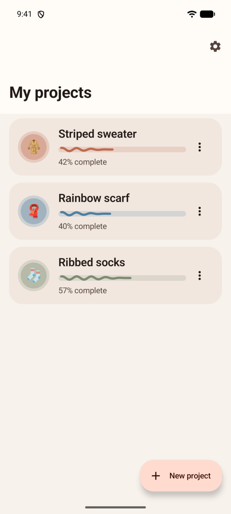
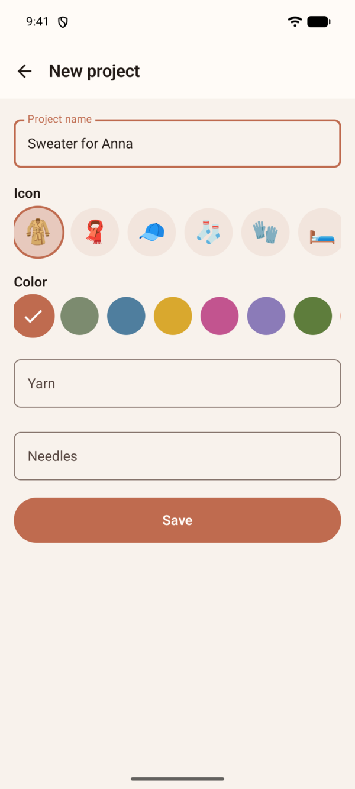
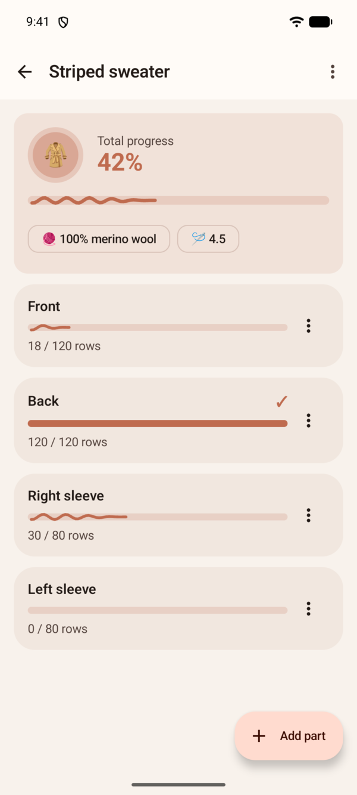
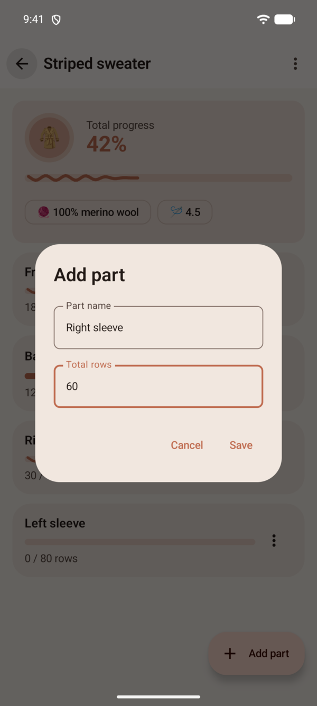
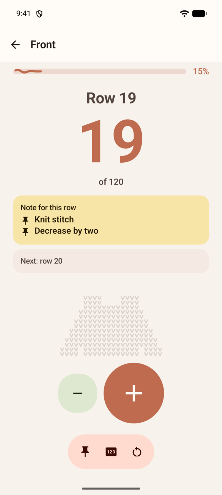
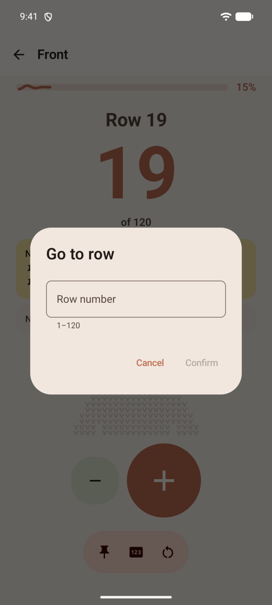
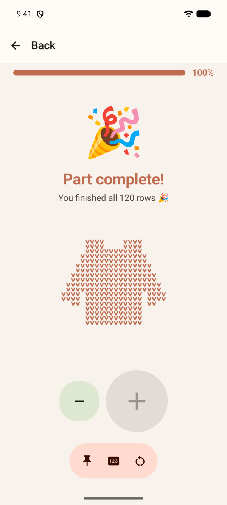
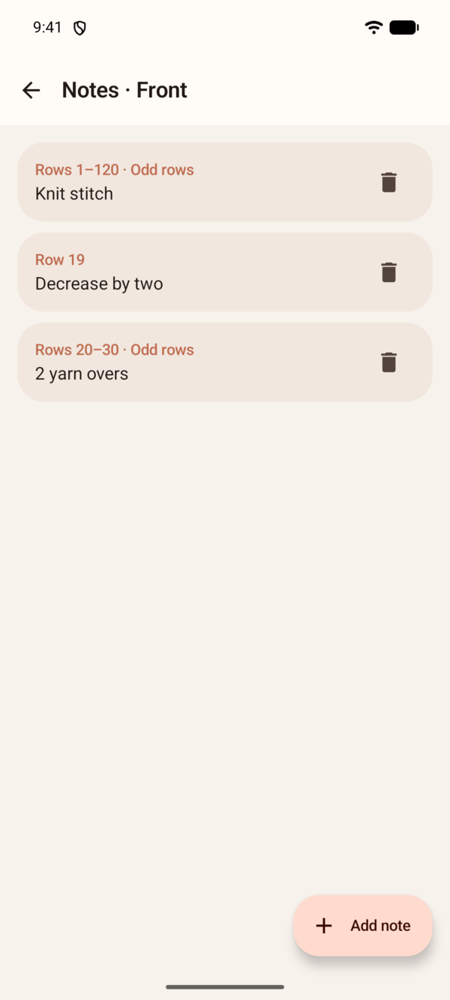
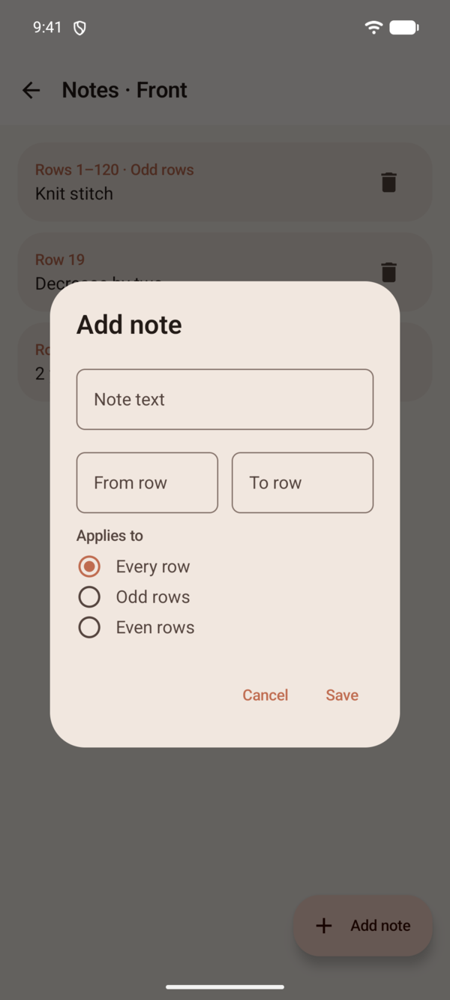
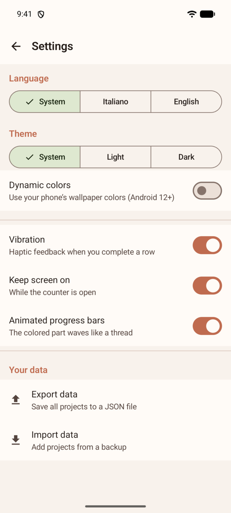

# Majon — User Guide 🧶

[Versione italiana](manuale.it.md)

Majon counts the rows of your knitting projects, reminds you of special
instructions at exactly the right moment, and shows how far you are from
the finish line.

> "Needles done" and "rows" mean the same here: every time you finish a row,
> tap **+**.

## Contents

1. [Create a project](#1-create-a-project)
2. [Add the parts](#2-add-the-parts)
3. [Count rows](#3-count-rows)
4. [Notes: instructions at the right moment](#4-notes--instructions-at-the-right-moment)
5. [Settings](#5-settings)
6. [Data backup](#6-data-backup)
7. [FAQ](#faq)

## 1. Create a project

The **My projects** screen shows all your work, each with its own progress
bar. The bar takes the project's color and the colored part gently waves,
like a thread.

1. Tap **New project**.
2. Give it a name (e.g. "Red sweater").
3. Pick an **icon** (sweater, scarf, hat, socks, gloves, blanket, bag, yarn
   ball) and a **color** — handy when you knit several similar things at
   once (three scarves? three colors). The icon also decides the shape of
   the garment that fills with color in the counter.
4. Optional: note the **yarn** (e.g. "100% merino wool") and the **needles**
   (e.g. "4.5"). Future-you will be grateful when re-knitting it.
5. **Save**.

To edit or delete a project: **⋮** menu on its card, or the top-right menu
inside the project.

## 2. Add the parts

A project splits into parts: front, back, sleeves, collar…

1. Open the project and tap **Add part**.
2. Enter a name (e.g. "Front") and the expected **total rows** (e.g. 120).

Total rows drive the progress percentage: the top card shows the whole
project's progress, every part has its own. A finished part shows a ✓.

The **⋮** menu of a part lets you **edit** it, open its **notes** or
**delete** it.

> If you reduce the total rows below the rows already done, the app warns
> you and the counter stops at the new total. Notes beyond the new total stay
> saved but no longer show up in the counter: they are flagged in red in the
> notes list.

## 3. Count rows

Tap a part to open the **counter**.

- The big number is the row **you are working on now**.
- **+** (big button): row finished. The counter advances with a small
  confirmation vibration and a ripple that radiates from the button.
- **−**: undo the last row (for accidental +).
- The bar with three icons at the bottom holds:
  - 📌 **Notes**: manage the part's instructions;
  - **123** **Go to row…**: jump to an exact row;
  - ↻ **Reset counter**: start over (notes are kept).
- Below the notes you'll see a **knitted garment** shaped like the project's
  icon: as you finish rows, its stitches take on color from the bottom up
  until the piece is complete.

The buttons and the bar always stay at the bottom of the screen: when the
content is long, only the part above scrolls.

### When you finish

Completing the last row brings confetti 🎉, the garment is fully colored and
the part is marked complete.

The screen stays on while the counter is open (can be turned off in
Settings).

## 4. Notes — instructions at the right moment

Instructions like "at row 19 decrease by two" become **notes**: they pop up
by themselves, highlighted, **when you are about to work that row** — and as
a preview already on the row before ("Next: row 19 · decrease by two").

From the counter: **📌 Notes → Add note**.

A note has:
- **Text**: the instruction ("decrease by two", "change color"…)
- **From row / To row**: a single row (19–19) or a range (20–30)
- **Applies to**: every row, **odd** rows only or **even** rows only

Real-life examples:

| Pattern instruction | How to enter it |
|---|---|
| "At row 19 decrease by 2" | row 19–19, every row |
| "From 20 to 25 decrease by 2" | rows 20–25, every row |
| "Odd rows in knit stitch" | rows 1–120, odd rows |
| "Odd rows 20 to 30: 2 yarn overs" | rows 20–30, odd rows |

At the start of the project enter all of the pattern's instructions: after
that you only press **+**. Tap a note to edit it, the trash icon to delete it.

## 5. Settings

Open them from the gear on the home screen.

- **Language**: System / Italiano / English — instant switch.
- **Theme**: System / Light / Dark.
- **Dynamic colors**: use your phone's wallpaper colors (Android 12+)
  instead of Majon's palette.
- **Vibration**: haptic feedback when you complete a row.
- **Keep screen on**: while the counter is open.
- **Animated progress bars**: turn the waving of the colored part on or off.
  When off, bars stay flat.

## 6. Data backup

Your data lives only on your phone. To keep it safe, in Settings →
**Your data**:

- **Export data**: saves everything (projects, parts, counts, notes) to a
  JSON file wherever you like (Drive, Downloads…).
- **Import data**: loads a backup. Imported projects are **added** to the
  existing ones, nothing is overwritten. The import is all-or-nothing: an
  invalid file changes nothing.

Handy when changing phones, or as a safety net before a cleanup.

## FAQ

**I tapped + by mistake.** Tap **−**.

**I lost count.** Count the rows on your work and use the **123** icon
(**Go to row…**).

**Can I knit several projects at once?** Yes, unlimited: every project and
every part keeps its own count.

**Are notes deleted when I reset the counter?** No, they stay saved.

**If I tap + very fast, do I lose counts?** No: every tap is counted.

**Does the app ask for permissions?** None. No internet, no ads: your data
stays yours.
