# Majon — User Guide 🧶

[Versione italiana](manuale.it.md)

Majon counts the rows of your knitting projects, reminds you of special
instructions at exactly the right moment, and shows how far you are from
the finish line.

> "Needles done" and "rows" mean the same here: every time you finish a row,
> tap **+**.

## Contents

1. [Create a project](#1-create-a-project)
2. [Add the parts](#2-add-the-parts)
3. [Count rows](#3-count-rows)
4. [Notes: instructions at the right moment](#4-notes--instructions-at-the-right-moment)
5. [The stash: yarn and needles](#5-the-stash-yarn-and-needles)
6. [Settings](#6-settings)
7. [Data backup](#7-data-backup)
8. [FAQ](#faq)

## 1. Create a project

The **My projects** screen shows all your work, each with its own progress
bar. The bar takes the project's color and the colored part gently waves,
like a thread.

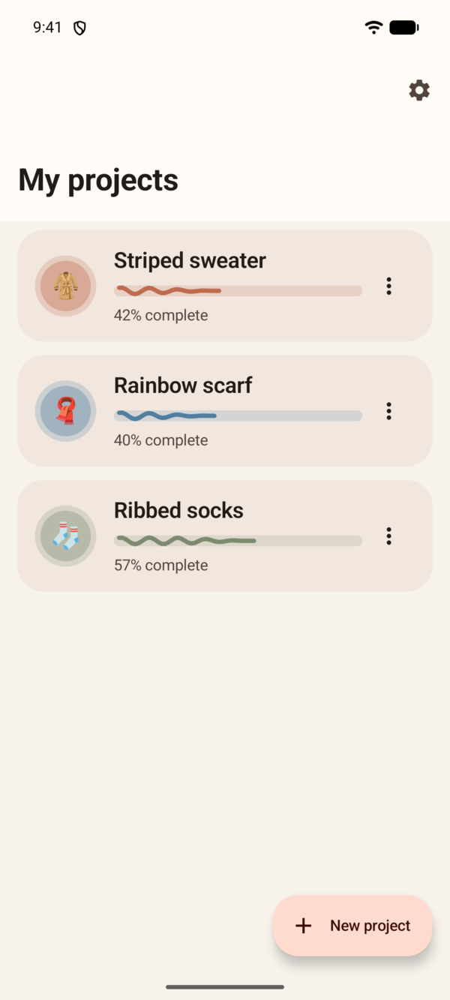
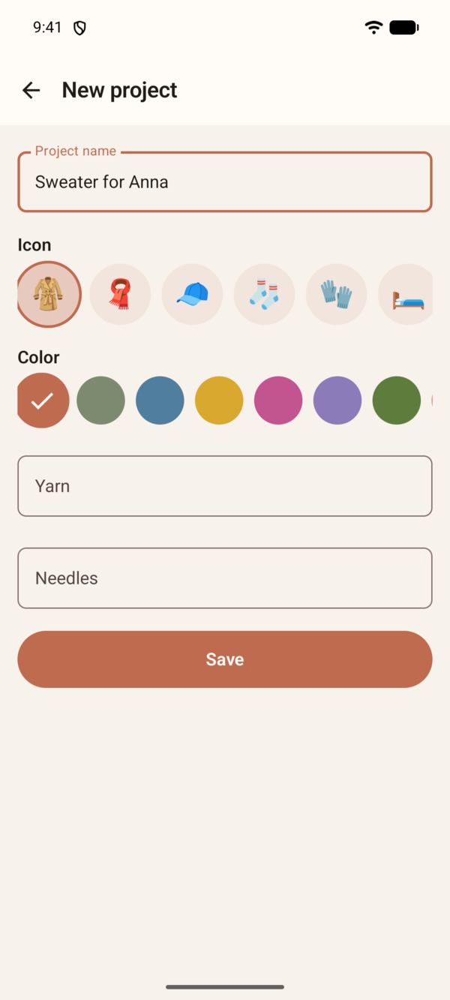

1. Tap **New project**.
2. Give it a name (e.g. "Red sweater").
3. Pick an **icon** (sweater, scarf, hat, socks, gloves, blanket, bag, yarn
   ball) and a **color** — handy when you knit several similar things at
   once (three scarves? three colors). The icon also decides the shape of
   the garment that fills with color in the counter.
4. Optional: note the **yarn** (e.g. "100% merino wool") and the **needles**
   (e.g. "4.5"). Future-you will be grateful when re-knitting it.
5. **Save**.

To edit or delete a project: **⋮** menu on its card, or the top-right menu
inside the project.

## 2. Add the parts

A project splits into parts: front, back, sleeves, collar…

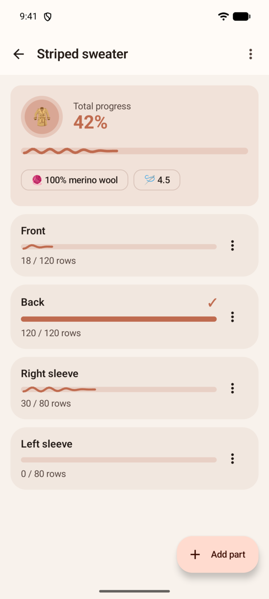
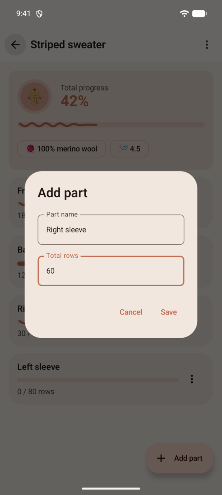

1. Open the project and tap **Add part**.
2. Enter a name (e.g. "Front") and the expected **total rows** (e.g. 120).

Total rows drive the progress percentage: the top card shows the whole
project's progress, every part has its own. A finished part shows a ✓.

Two optional switches per part:

- **Preparation row (row 0)**: a row before row 1 (casting on, a setup
  round…). It shows as “Row 0”, with its own colour and note.
- **Final joining row**: a row after the last one, to join the part to
  another. It shows as “Final row”, with its own colour and note.

Both count towards progress, but not in the “total rows” (those are the real
rows, 1 to N). You can switch them on or off after starting: the counter stays
on the same row.

The **⋮** menu of a part lets you **edit** it, open its **notes** or
**delete** it.

> If you reduce the total rows below the rows already done, the app warns
> you and the counter stops at the new total. Notes beyond the new total stay
> saved but no longer show up in the counter: they are flagged in red in the
> notes list.

## 3. Count rows

Tap a part to open the **counter**.

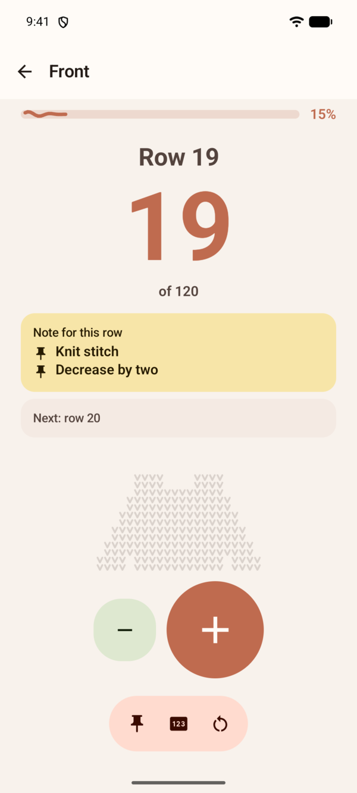
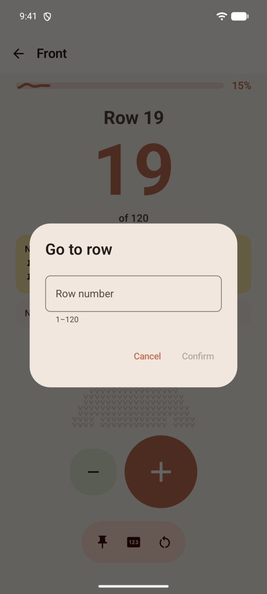

- The big number is the row **you are working on now**. It has a *muted*
  colour and the label “In progress”.
- **+** (big button): row finished. The number lights up for a moment in its
  full colour (“Done ✓”) and then becomes the next row, muted again. A small
  confirmation vibration and a ripple from the button.
- **−**: undo the last row (for accidental +).
- The bar with three icons at the bottom holds:
  - 📌 **Notes**: manage the part's instructions;
  - **123** **Go to row…**: jump to an exact row;
  - ↻ **Reset counter**: start over (notes are kept);
  - 🎙 **Voice commands**: turn listening on (see below).
- Below the notes you'll see a **knitted garment** shaped like the project's
  icon: as you finish rows, its stitches take on color from the bottom up
  until the piece is complete.

The buttons and the bar always stay at the bottom of the screen: when the
content is long, only the part above scrolls.

### Voice commands

With your hands busy with the needles you can talk to your phone. Tap 🎙 in
the bottom bar: the first time Majon explains how it works and asks for
microphone permission. From then on it listens continuously, **only while
this screen is open and the microphone is on** ("Listening…" appears, plus
Android's green dot). It switches itself off when you leave the screen or
lock the phone, and you turn it on again each time.

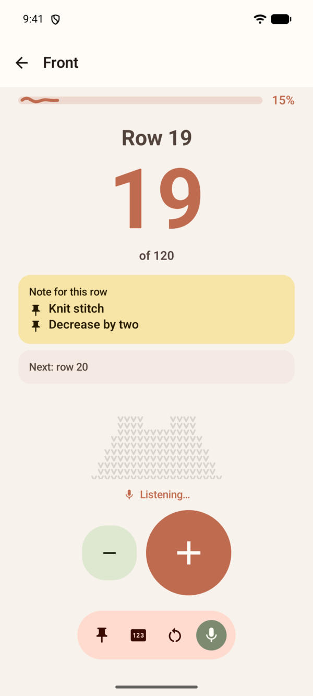

| Say | What happens |
|---|---|
| "next", "done", "row done", "plus" | row finished (+1) |
| "back", "undo", "minus" | undo the last row (−1) |
| "go to row 40" (or "forty") | jump to that row |
| "read note", "what to do" | reads the row's note out loud |
| "how many rows left" | tells how many rows remain |
| "reset" → "confirm" | resets the counter, only after a spoken confirmation |

Commands also work in Italian ("avanti", "indietro", "vai alla riga 40"…).
Only short phrases count, so chatter in the room won't move the counter. If
after "reset" you say anything else, or wait 10 seconds, the reset is
cancelled.

For spoken answers ("Row 41") see **Spoken replies** in Settings.
Recognition is done by the phone's speech service: if the language isn't
installed offline, it may use the internet.

### Volume keys

If you turn them on in Settings, in the counter **volume up** = row done and
**volume down** = undo, without looking at the screen.

### Moving on to the next part

If you press **+** on the last row of a part and there is another unfinished
part after it, the app asks “Move on to …?”. Confirm and the part is closed
(with confetti), then the next part's counter opens a moment later; “Stay
here” changes nothing. Hands-free: say “confirm” (any other command cancels),
or **volume up** = yes and **volume down** = no. Parts follow the order you
created them in. The **←** button takes you back to the project.

### When you finish

Completing the last row brings confetti 🎉, the garment is fully colored and
the part is marked complete.

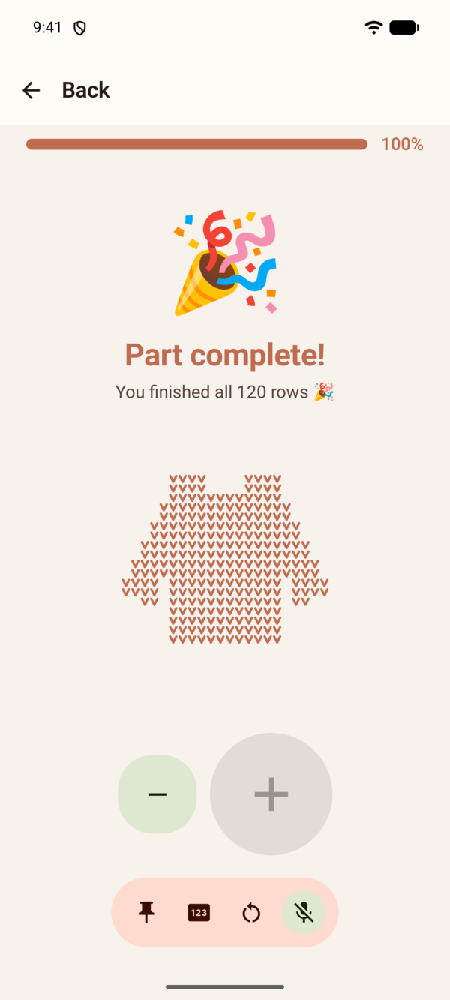

The screen stays on while the counter is open (can be turned off in
Settings).

## 4. Notes — instructions at the right moment

Instructions like "at row 19 decrease by two" become **notes**: they pop up
by themselves, highlighted, **when you are about to work that row** — and as
a preview already on the row before ("Next: row 19 · decrease by two").

From the counter: **📌 Notes → Add note**.

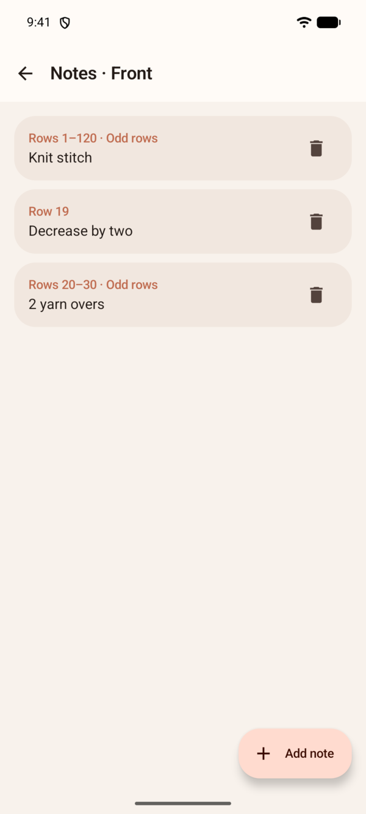
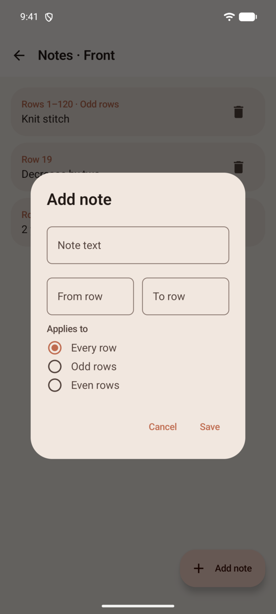

A note has:
- **Text**: the instruction ("decrease by two", "change color"…)
- **From row / To row**: a single row (19–19) or a range (20–30)
- **Applies to**: every row, **odd** rows only or **even** rows only

Real-life examples:

| Pattern instruction | How to enter it |
|---|---|
| "At row 19 decrease by 2" | row 19–19, every row |
| "From 20 to 25 decrease by 2" | rows 20–25, every row |
| "Odd rows in knit stitch" | rows 1–120, odd rows |
| "Odd rows 20 to 30: 2 yarn overs" | rows 20–30, odd rows |

At the start of the project enter all of the pattern's instructions: after
that you only press **+**. Tap a note to edit it, the trash icon to delete it.

## 5. The stash: yarn and needles

In the bottom bar, **Stash** holds everything you own, in two tabs: **Yarns**
and **Needles**. Everything is optional: fill in only what is useful to you.

### Yarns

Tap **New yarn** (a name is enough; the rest is optional):

- **Brand, colour** (name and shade), **dye lot**, **weight** (lace,
  fingering, DK, worsted…).
- **Composition**: one or more fibres, each with its percentage (or none:
  “wool and silk”). The total cannot exceed 100%.
- **Skein weight and length** (e.g. 100 g, 350 m, as on the label).
- **Skeins you have**: halves and quarters too (2.5; **−** and **+** move by a
  quarter). The app works out the grams and metres left by itself.
- Price, where you bought it, care, notes and a **photo**.

Opening a yarn shows the stock and lets you update it: **−** / **+** by
quarters, or **I used…** to take off the skeins you have used. The stock never
goes down by itself and never below zero.

### Gauge: the 10×10 cm swatch

Yarn labels show the 10×10 cm square with the stitches, rows and needles used.
The app draws the same: in a yarn, tap **Add swatch** and enter the **stitches**
and **rows** in 10 cm, the **needles** and the **stitch pattern** (stockinette,
garter, rib…). You see the drawing take shape as you type. If you weigh the
swatch you can also enter its **weight** (grams): it will be used to estimate how
much yarn a project needs.

A yarn can have several swatches: the gauge changes with the needles and the
stitch pattern.

### Needles

In the **Needles** tab, **New needles**: **type** (circular, straight,
double-pointed, interchangeable), **material**, **size** in mm, **length** in cm,
**quantity** (pairs or sets), brand and notes. They are sorted by size.

## 6. Settings

Open them from the gear on the home screen.

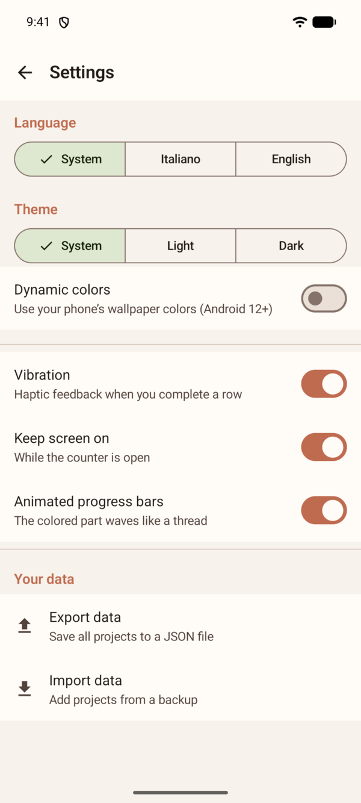

- **Language**: System / Italiano / English — instant switch.
- **Theme**: System / Light / Dark.
- **Palette**: Cheerful / Classic / Forest.
- **Dynamic colors**: use your phone's wallpaper colors (Android 12+)
  instead of Majon's palette.
- **Vibration**: haptic feedback when you complete a row.
- **Keep screen on**: while the counter is open.
- **Animated progress bars**: turn the waving of the colored part on or off.
  When off, bars stay flat.
- **Spoken replies**: the phone answers voice commands out loud (current
  row, notes, rows left). When off, commands work silently.
- **Volume keys**: in the counter, volume up = row done, volume down = undo.
  Off by default.

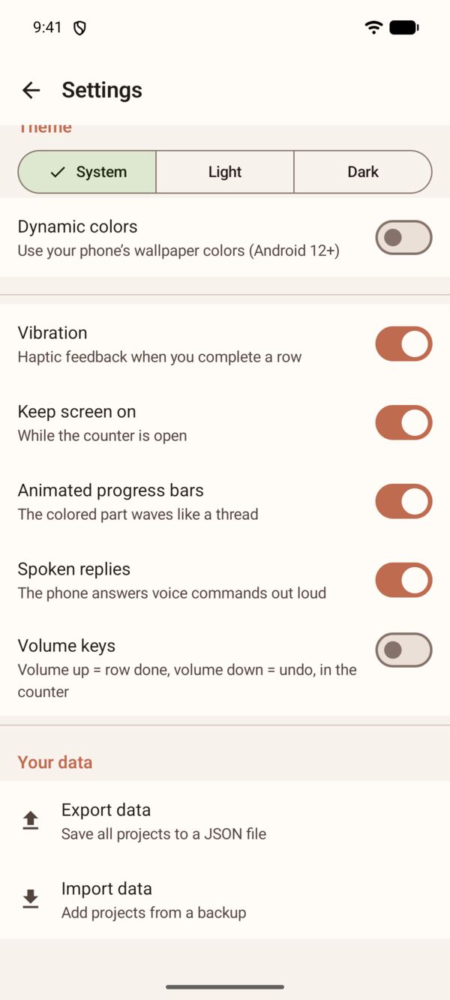

## 7. Data backup

Your data lives only on your phone. To keep it safe, in Settings →
**Your data**:

- **Export data**: saves everything (projects, parts, counts, notes, yarns with their
  swatches, needles) to a JSON file wherever you like (Drive, Downloads…).
- **Import data**: loads a backup. Imported projects are **added** to the
  existing ones, nothing is overwritten. Yarn photos are not included in
  the file. The import is all-or-nothing: an
  invalid file changes nothing.

Handy when changing phones, or as a safety net before a cleanup.

## FAQ

**I tapped + by mistake.** Tap **−**.

**I lost count.** Count the rows on your work and use the **123** icon
(**Go to row…**).

**Can I knit several projects at once?** Yes, unlimited: every project and
every part keeps its own count.

**Are notes deleted when I reset the counter?** No, they stay saved.

**If I tap + very fast, do I lose counts?** No: every tap is counted.

**Does the app ask for permissions?** Only the microphone, and only if you
turn on voice commands in the counter. The app doesn't use the internet, has
no ads and never saves audio: your data stays yours.

**Voice commands don't understand me.** Speak clearly in short phrases, and
check that the app's language is installed in your phone's speech
recognition (Android Settings → Languages → Voice input).
