# Majon — Manuale utente 🧶

[English version](manual.en.md)

Majon conta le righe dei tuoi lavori a maglia, ti ricorda le istruzioni
speciali al momento giusto e ti mostra quanto manca alla fine.

> "Ferri" e "righe" sono sinonimi: ogni volta che completi un ferro, premi **+**.

## Indice

1. [Creare un progetto](#1-creare-un-progetto)
2. [Aggiungere le parti](#2-aggiungere-le-parti)
3. [Contare le righe](#3-contare-le-righe)
4. [Le note: istruzioni al momento giusto](#4-le-note--istruzioni-al-momento-giusto)
5. [Lo stash: lane e ferri](#5-lo-stash-lane-e-ferri)
6. [Impostazioni](#6-impostazioni)
7. [Backup dei dati](#7-backup-dei-dati)
8. [Domande frequenti](#domande-frequenti)

## 1. Creare un progetto

Nella schermata **I miei progetti** vedi tutti i tuoi lavori, ognuno con la
sua barra di avanzamento. La barra si colora con il colore del progetto e il
tratto colorato ondeggia leggermente, come un filo.

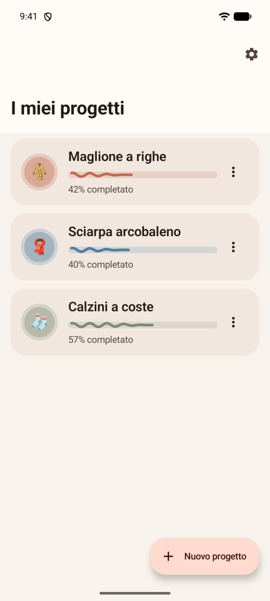
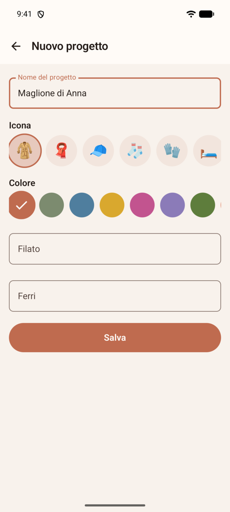

1. Tocca **Nuovo progetto**.
2. Dai un nome (es. "Maglione rosso").
3. Scegli un'**icona**: è anche il **tipo di progetto** (maglione, cardigan,
   sciarpa, scaldacollo, scialle, cappello, fascia per capelli, calze, guanti,
   pantofole, coperta, borsa, presina o quadrato, altro) e un **colore**: così
   distingui a colpo d'occhio più progetti uguali (tre sciarpe? tre colori
   diversi). L'icona decide la forma del capo che si colora nel contatore e le
   **parti suggerite** (vedi sotto).
4. Facoltativo: scegli dallo **stash** le **lane** e i **ferri** che userai
   (vedi il capitolo sullo stash). La lana **principale** (la stellina) è
   quella su cui l'app fa i calcoli; per ogni lana puoi scegliere il
   **campione** da usare e, se lo conosci, i **gomitoli richiesti dal
   modello**. I ferri già usati in un altro lavoro non finito sono segnati
   «In uso in: …», così non li prometti due volte. I vecchi appunti di testo su
   filato e ferri, se li avevi, restano modificabili.
5. **Salva**.

Per modificare o eliminare un progetto: menu **⋮** sulla sua scheda, oppure
menu in alto a destra dentro il progetto.

### Nuovo progetto simile

Dal menu **⋮** (sulla scheda o dentro il progetto) scegli **Nuovo progetto
simile**: l'app crea una copia, con le stesse parti (misure, righe 0 e finale,
note per riga), le stesse lane e gli stessi ferri, ma con i conteggi a zero, e
la apre subito nel modulo di modifica: cambia nome, misure, lana o ferri e hai
già il nuovo lavoro pronto.

## 2. Aggiungere le parti

Un progetto si divide in parti: davanti, dietro, maniche, collo…

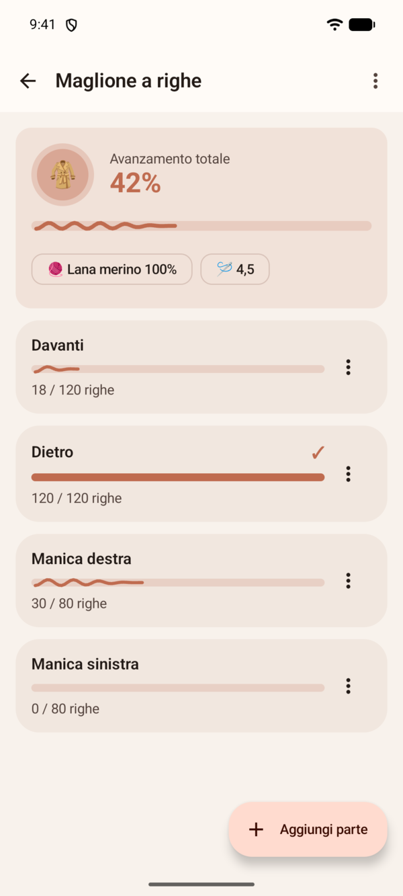
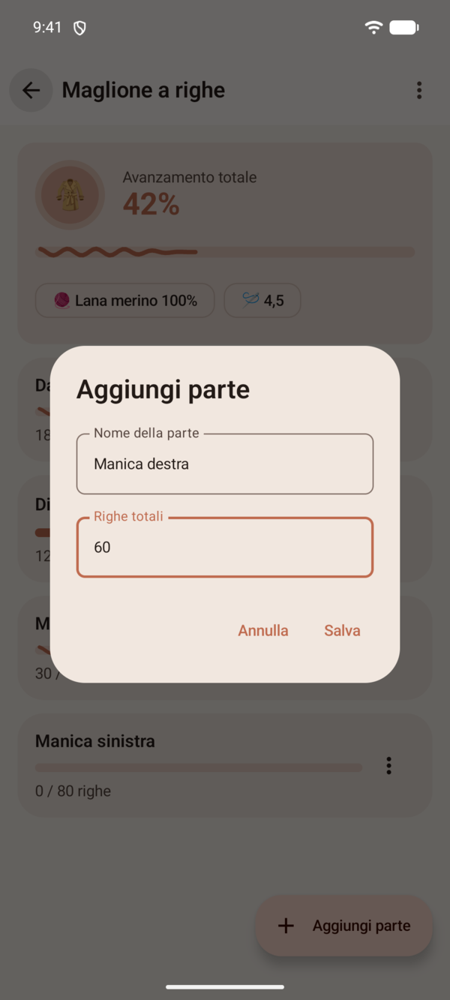

1. Apri il progetto e tocca **Aggiungi parte**.
2. Scegli un nome (es. "Davanti") e le **righe totali** previste (es. 120).

### Misure e parti suggerite (facoltativo)

Se aggiungendo una parte hai già le **righe**, scrivile e basta: le misure non
servono. Se invece parti dalle **misure**, il modulo ti propone le **parti
tipiche** del tipo di progetto (es. per un maglione Davanti, Dietro, Manica;
per una fascia un pezzo unico) e i campi giusti: **larghezza** o **giro** nel
senso dei punti, **lunghezza** o **altezza** nel senso delle righe, in cm.

Con una lana collegata al progetto (e il suo campione) l'app stima **quanti
punti avviare e quante righe fare** («Circa 52 punti da avviare e 510 righe»);
il pulsante **Usa 510 righe come totale** le copia nel campo delle righe. La
stima compare anche sulla scheda della parte (~52 punti · ~510 righe). Se per
una parte vuoi un campione diverso da quello della lana principale, sceglilo
nell'elenco **Campione per questa parte**.

Le righe totali servono per la percentuale di avanzamento: in alto trovi il
progresso complessivo del progetto, ogni parte ha il suo. Una parte finita
mostra una spunta ✓.

Due interruttori opzionali, per ogni parte:

- **Riga di preparazione (riga 0)**: una riga prima della numero 1 (es. avvio
  delle maglie, un giro di ferri). Compare come «Riga 0», con un colore e una
  nota tutti suoi.
- **Riga finale di raccordo**: una riga dopo l'ultima, per unire la parte a
  un'altra. Compare come «Riga finale», con colore e nota propri.

Entrambe contano nell'avanzamento, ma non nelle «righe totali» (che sono le
righe vere, da 1 a N). Puoi attivarle o toglierle anche a lavoro iniziato: il
contatore resta sulla stessa riga.

Dal menu **⋮** di una parte puoi **modificarla**, aprirne le **note** o
**eliminarla**.

> Se riduci le righe totali sotto quelle già fatte, l'app ti avvisa e il
> contatore si ferma al nuovo totale. Le note oltre il nuovo totale restano
> salvate ma non compaiono più nel contatore: nell'elenco note sono segnate
> in rosso.

## 3. Contare le righe

Tocca una parte per aprire il **contatore**.

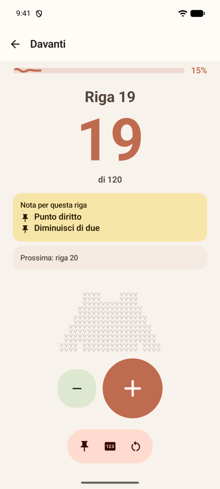
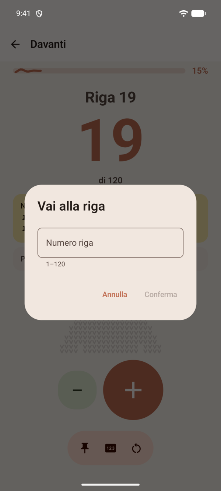

- Il numero grande è la riga **che stai facendo ora**. Ha un colore
  *tenue* e la scritta «In lavorazione».
- **+** (pulsante grande): riga finita. Il numero si accende per un istante
  del suo colore pieno («Fatta ✓») e poi diventa la riga successiva, di nuovo
  tenue. Piccola vibrazione di conferma e un'onda che parte dal pulsante.
- **−**: annulla l'ultima riga (per i + di troppo).
- La barra con le tre icone in basso contiene:
  - 📌 **Note**: gestisci le istruzioni della parte;
  - **123** **Vai alla riga…**: salta a un punto preciso;
  - ↻ **Azzera contatore**: ricomincia da capo (le note restano);
  - 🎙 **Comandi vocali**: attiva l'ascolto (vedi sotto).
- Sotto le note trovi un **capo a maglia** della forma dell'icona del
  progetto: man mano che completi righe, i punti si colorano dal basso verso
  l'alto, fino a completare il lavoro.

I pulsanti e la barra restano sempre in fondo allo schermo: se il contenuto è
lungo, scorre solo la parte sopra.

### Comandi vocali

Con le mani occupate dai ferri puoi parlare al telefono. Tocca 🎙 nella barra
in basso: la prima volta Majon ti spiega come funziona e chiede il permesso
del microfono. Da quel momento ascolta di continuo, **solo mentre questa
schermata è aperta e il microfono è attivo** (compare "In ascolto…" e il
pallino verde di Android). Si spegne da solo se esci dalla schermata o
blocchi il telefono, e ogni volta lo riattivi tu.

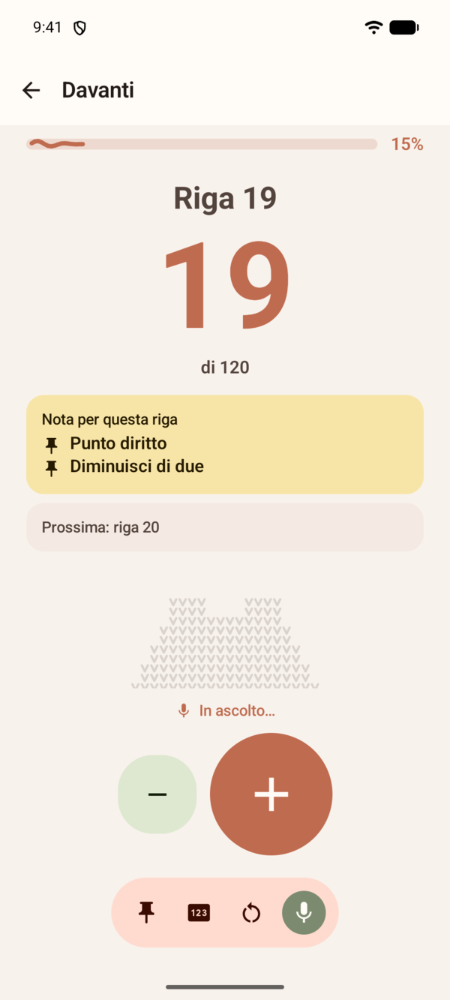

| Dici | Succede |
|---|---|
| «avanti», «fatto», «riga fatta», «più» | riga fatta (+1) |
| «indietro», «annulla», «meno» | annulla l'ultima riga (−1) |
| «vai alla riga 40» (anche «quaranta») | salta a quella riga |
| «leggi la nota», «cosa devo fare» | legge a voce la nota della riga |
| «quante righe mancano» | dice quante righe restano |
| «azzera» → «conferma» | azzera il contatore, solo dopo conferma a voce |

I comandi funzionano anche in inglese («next», «back», «go to row 40», «read
note», «how many rows left», «reset»). Contano solo frasi brevi, così le
chiacchiere in stanza non spostano il contatore. Se dopo «azzera» dici
qualunque altra cosa, o aspetti 10 secondi, l'azzeramento è annullato.

Per le risposte a voce ("Riga 41") vedi **Risposte vocali** nelle
Impostazioni. Il riconoscimento lo fa il servizio vocale del telefono: se la
lingua non è installata offline, può usare internet.

### Tasti volume

Se li attivi nelle Impostazioni, nel contatore **volume su** = riga fatta e
**volume giù** = annulla, senza guardare lo schermo.

### Passare alla parte successiva

Se premi **+** sull'ultima riga di una parte e dopo c'è un'altra parte non
finita, l'app chiede «Passare a …?». Confermando, la parte si chiude (con i
coriandoli) e dopo un attimo si apre il contatore della successiva; con
«Resta qui» non cambia niente. A mani libere: dì «conferma» (qualsiasi altro
comando annulla), oppure **volume su** = sì e **volume giù** = no. Le parti
si seguono nell'ordine in cui le hai create. Con **←** torni al progetto.

### A lavoro finito

Quando completi l'ultima riga arrivano i coriandoli 🎉, il capo è tutto
colorato e la parte risulta completata.

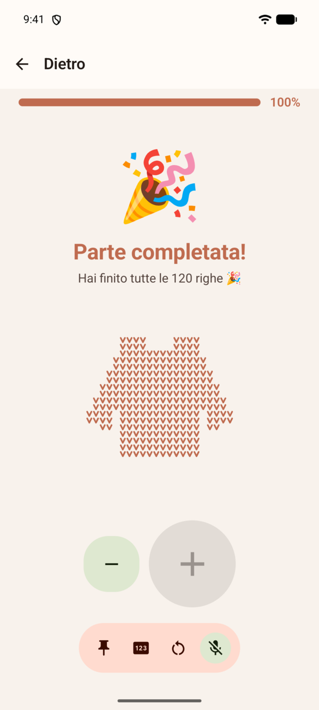

Lo schermo resta acceso finché il contatore è aperto (disattivabile nelle
Impostazioni).

## 4. Le note — istruzioni al momento giusto

Le istruzioni tipo "alla riga 19 diminuisci di due" diventano **note**:
compaiono da sole, evidenziate, **quando stai per fare quella riga** — e in
anteprima già alla riga prima ("Prossima: riga 19 · diminuisci di due").

Dal contatore: icona **📌 Note → Aggiungi nota**.

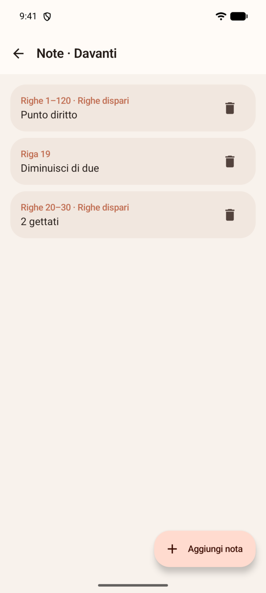
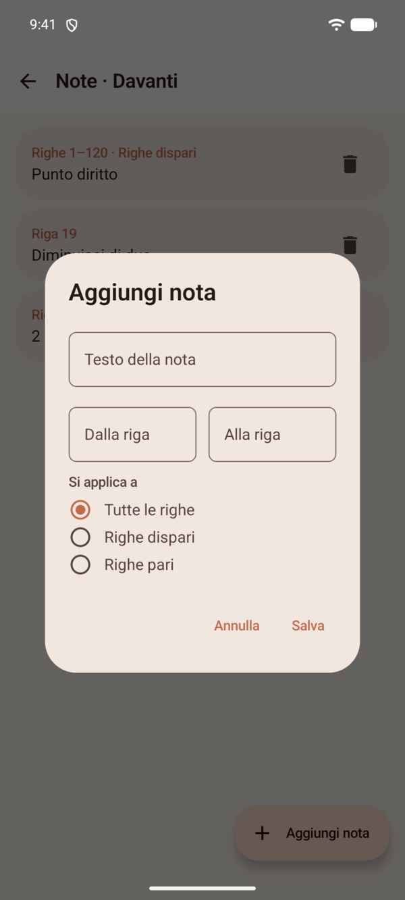

Una nota ha:
- **Testo**: l'istruzione ("diminuisci di due", "cambia colore"…)
- **Dalla riga / Alla riga**: una riga sola (19–19) o un intervallo (20–30)
- **Si applica a**: tutte le righe, solo **dispari** o solo **pari**

Esempi presi dalla pratica:

| Istruzione del modello | Come la inserisci |
|---|---|
| "Alla riga 19 diminuisci di 2" | riga 19–19, tutte le righe |
| "Dalla 20 alla 25 diminuisci di 2" | righe 20–25, tutte le righe |
| "Le righe dispari a punto diritto" | righe 1–120, righe dispari |
| "Dispari dalla 20 alla 30: 2 gettati" | righe 20–30, righe dispari |

All'inizio del lavoro inserisci tutte le istruzioni del modello: poi pensi
solo a premere **+**. Tocca una nota per modificarla, il cestino per
eliminarla.

## 5. Lo stash: lane e ferri

Nella barra in basso, **Stash** raccoglie tutto quello che hai: due schede,
**Lane** e **Ferri**. Tutto è facoltativo: inserisci solo quello che ti serve.

### Le lane

Tocca **Nuova lana** (il nome basta; il resto è facoltativo):

- **Marca, colore** (nome e tinta), **lotto di tintura**, **spessore**
  (lace, fingering, DK, worsted…).
- **Composizione**: una o più fibre, ognuna con la sua percentuale (anche
  senza percentuale: «lana e seta»). Il totale non può superare il 100%.
- **Peso e metri del gomitolo** (es. 100 g, 350 m, come sul cartellino).
- **Gomitoli che hai**: anche a metà o a quarti (2,5; il **−** e il **+**
  muovono di un quarto). L'app ricava da sola i grammi e i metri rimasti.
- Prezzo, dove l'hai comprata, cura e lavaggio, note e una **foto**.

Aprendo una lana vedi la scorta e puoi aggiornarla: **−** / **+** a quarti,
oppure **Ho usato…** per scalare quanti gomitoli hai consumato. Lo stock non
scende mai da solo e non va sotto zero.

### La resa: il campione 10×10 cm

Sul cartellino dei gomitoli c'è il quadrato 10×10 cm con i punti, le righe e i
ferri usati. Lo ritrovi uguale nell'app: in una lana tocca **Aggiungi
campione** e inserisci **punti** e **righe** in 10 cm, i **ferri** e il
**punto** (maglia rasata, legaccio, coste…). Vedi il disegno comporsi mentre
scrivi. Se pesi il campione puoi segnare anche il **peso** (grammi): servirà
a stimare quanta lana serve per un progetto.

Una lana può avere più campioni: la resa cambia con i ferri e con il punto.

### «Ce la faccio con questa lana?»

Nel progetto, la scheda **Lane e ferri** confronta quello che serve con quello
che hai:

- **Servono circa 1,2 · ne hai 2½ — Ce la fai con quello che hai**, oppure
  **Te ne mancano circa ¾** (arrotondato al quarto di gomitolo, come
  compreresti).
- Il fabbisogno si stima dalle **misure delle parti** e dal **peso del
  campione** (area ÷ 100 cm² × peso del campione, diviso il peso del gomitolo).
  Se il modello indica i gomitoli richiesti, vale quello. Solo la lana
  principale si stima da sola; per le altre serve il dato del modello.
- Se manca qualcosa (misure, peso del campione, peso del gomitolo) l'app lo
  dice e non inventa numeri.
- **Ho usato…** scala dallo stash i gomitoli che hai consumato (già
  proposti dalla stima): lo stock non cala mai da solo.

### I ferri

Nella scheda **Ferri**, **Nuovi ferri**: **tipo** (circolari, dritti, doppia
punta, intercambiabili), **materiale**, **misura** in mm, **lunghezza** in cm,
**quantità** (quante paia o set), marca e note. Sono ordinati per misura.

## 6. Impostazioni

Si aprono dall'ingranaggio nella schermata principale.

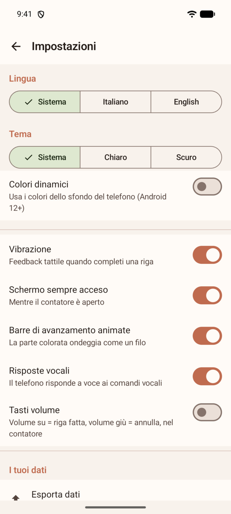

- **Lingua**: Sistema / Italiano / English — cambio immediato.
- **Tema**: Sistema / Chiaro / Scuro.
- **Palette**: Allegro / Classico / Bosco.
- **Colori dinamici**: usa i colori dello sfondo del telefono (Android 12+)
  al posto della palette di Majon.
- **Vibrazione**: feedback tattile quando completi una riga.
- **Schermo sempre acceso**: mentre il contatore è aperto.
- **Barre di avanzamento animate**: attiva o disattiva l'ondeggiamento della
  parte colorata. Spento, le barre restano piatte.
- **Risposte vocali**: il telefono risponde a voce ai comandi vocali (riga
  attuale, note, righe rimaste). Spento, i comandi funzionano in silenzio.
- **Tasti volume**: nel contatore, volume su = riga fatta, volume giù =
  annulla. Spento per impostazione predefinita.

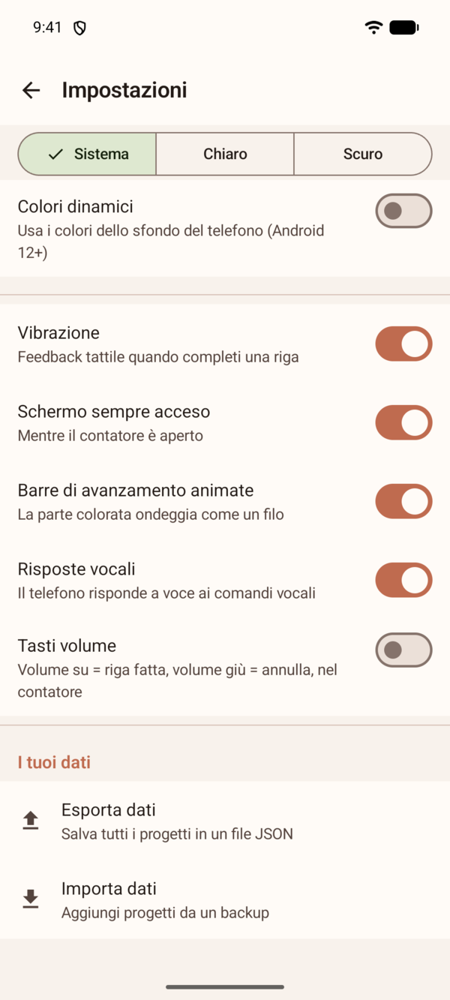

## 7. Backup dei dati

I dati vivono solo sul tuo telefono. Per non perderli, in Impostazioni →
**I tuoi dati**:

- **Esporta dati**: salva tutto (progetti, parti, conteggi, note, lane con i loro
  campioni, ferri) in un file JSON dove preferisci (Drive, Download…).
- **Importa dati**: ricarica un backup. I progetti importati si **aggiungono**
  a quelli esistenti, niente viene sovrascritto. Le foto delle lane non
  vengono incluse nel file. L'importazione è tutto o
  niente: se il file non è valido non cambia nulla.

Utile per cambiare telefono o per sicurezza prima di fare pulizia.

## Domande frequenti

**Ho premuto + per sbaglio.** Premi **−**.

**Ho perso il conto.** Conta le righe sul lavoro e usa l'icona **123**
(**Vai alla riga…**).

**Posso fare più progetti insieme?** Sì, senza limiti: ogni progetto e ogni
parte mantengono il proprio conteggio.

**Le note si cancellano quando azzero il contatore?** No, restano salvate.

**Se tocco + velocemente perdo dei conteggi?** No: ogni tocco viene contato.

**L'app chiede permessi?** Solo il microfono, e solo se attivi i comandi
vocali nel contatore. L'app non usa internet, non ha pubblicità e non salva
l'audio: i dati restano tuoi.

**I comandi vocali non capiscono.** Parla chiaro e con frasi brevi; controlla
che la lingua dell'app sia installata nel riconoscimento vocale del telefono
(Impostazioni di Android → Lingue → Digitazione vocale).
