# Majon — Manuale utente 🧶

[English version](manual.en.md)

Majon conta le righe dei tuoi lavori a maglia, ti ricorda le istruzioni
speciali al momento giusto e ti mostra quanto manca alla fine.

> "Ferri" e "righe" sono sinonimi: ogni volta che completi un ferro, premi **+**.

## Indice

1. [Creare un progetto](#1-creare-un-progetto)
2. [Aggiungere le parti](#2-aggiungere-le-parti)
3. [Contare le righe](#3-contare-le-righe)
4. [Le note: istruzioni al momento giusto](#4-le-note--istruzioni-al-momento-giusto)
5. [Impostazioni](#5-impostazioni)
6. [Backup dei dati](#6-backup-dei-dati)
7. [Domande frequenti](#domande-frequenti)

## 1. Creare un progetto

Nella schermata **I miei progetti** vedi tutti i tuoi lavori, ognuno con la
sua barra di avanzamento. La barra si colora con il colore del progetto e il
tratto colorato ondeggia leggermente, come un filo.

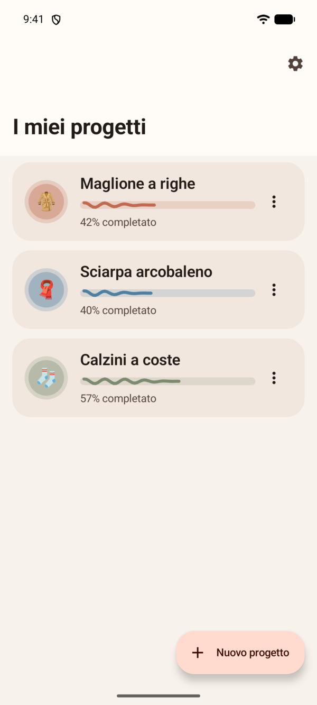
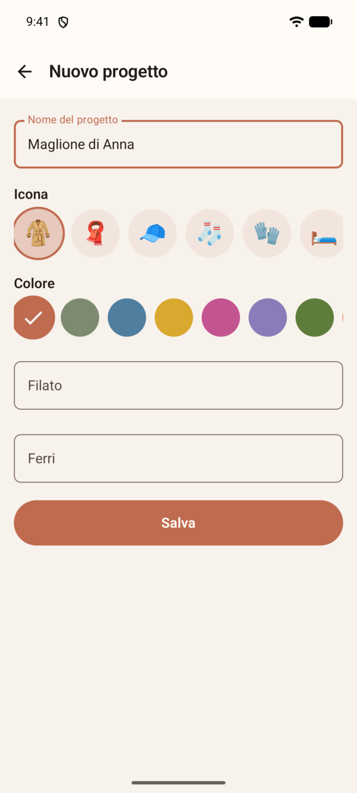

1. Tocca **Nuovo progetto**.
2. Dai un nome (es. "Maglione rosso").
3. Scegli un'**icona** (maglione, sciarpa, berretto, calzini, guanti, coperta,
   borsa, gomitolo) e un **colore**: così distingui a colpo d'occhio più
   progetti uguali (tre sciarpe? tre colori diversi). L'icona decide anche la
   forma del capo che si colora nel contatore.
4. Facoltativo: annota **filato** (es. "lana merino 100%") e **ferri**
   (es. "4,5"). Ti serviranno quando vorrai rifare il lavoro.
5. **Salva**.

Per modificare o eliminare un progetto: menu **⋮** sulla sua scheda, oppure
menu in alto a destra dentro il progetto.

## 2. Aggiungere le parti

Un progetto si divide in parti: davanti, dietro, maniche, collo…

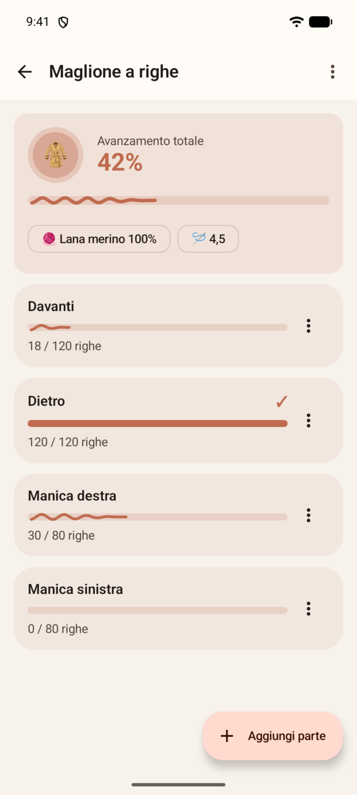
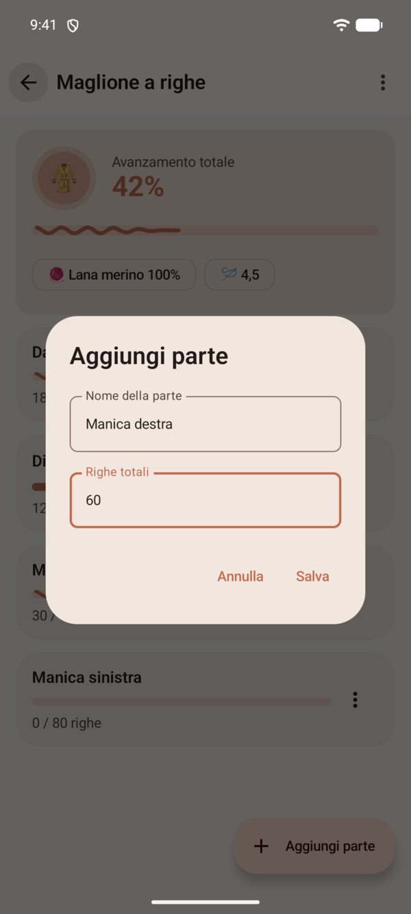

1. Apri il progetto e tocca **Aggiungi parte**.
2. Scegli un nome (es. "Davanti") e le **righe totali** previste (es. 120).

Le righe totali servono per la percentuale di avanzamento: in alto trovi il
progresso complessivo del progetto, ogni parte ha il suo. Una parte finita
mostra una spunta ✓.

Dal menu **⋮** di una parte puoi **modificarla**, aprirne le **note** o
**eliminarla**.

> Se riduci le righe totali sotto quelle già fatte, l'app ti avvisa e il
> contatore si ferma al nuovo totale. Le note oltre il nuovo totale restano
> salvate ma non compaiono più nel contatore: nell'elenco note sono segnate
> in rosso.

## 3. Contare le righe

Tocca una parte per aprire il **contatore**.

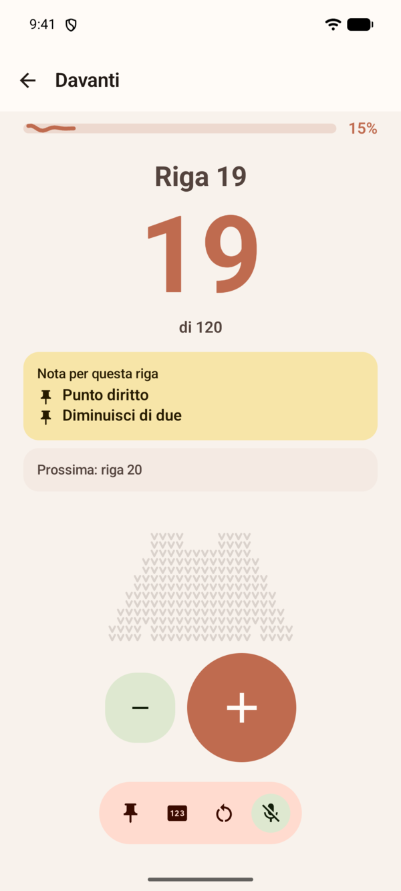
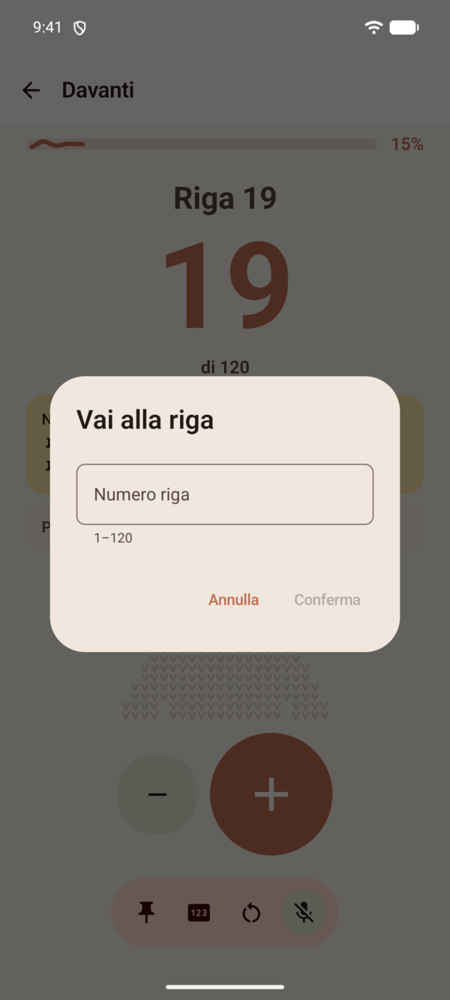

- Il numero grande è la riga **che stai facendo ora**.
- **+** (pulsante grande): riga finita. Il contatore avanza con una piccola
  vibrazione di conferma e un'onda che parte dal pulsante.
- **−**: annulla l'ultima riga (per i + di troppo).
- La barra con le tre icone in basso contiene:
  - 📌 **Note**: gestisci le istruzioni della parte;
  - **123** **Vai alla riga…**: salta a un punto preciso;
  - ↻ **Azzera contatore**: ricomincia da capo (le note restano);
  - 🎙 **Comandi vocali**: attiva l'ascolto (vedi sotto).
- Sotto le note trovi un **capo a maglia** della forma dell'icona del
  progetto: man mano che completi righe, i punti si colorano dal basso verso
  l'alto, fino a completare il lavoro.

I pulsanti e la barra restano sempre in fondo allo schermo: se il contenuto è
lungo, scorre solo la parte sopra.

### Comandi vocali

Con le mani occupate dai ferri puoi parlare al telefono. Tocca 🎙 nella barra
in basso: la prima volta Majon ti spiega come funziona e chiede il permesso
del microfono. Da quel momento ascolta di continuo, **solo mentre questa
schermata è aperta e il microfono è attivo** (compare "In ascolto…" e il
pallino verde di Android). Si spegne da solo se esci dalla schermata o
blocchi il telefono, e ogni volta lo riattivi tu.

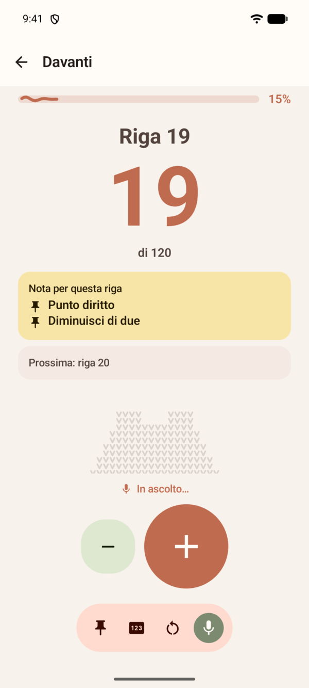

| Dici | Succede |
|---|---|
| «avanti», «fatto», «riga fatta», «più» | riga fatta (+1) |
| «indietro», «annulla», «meno» | annulla l'ultima riga (−1) |
| «vai alla riga 40» (anche «quaranta») | salta a quella riga |
| «leggi la nota», «cosa devo fare» | legge a voce la nota della riga |
| «quante righe mancano» | dice quante righe restano |
| «azzera» → «conferma» | azzera il contatore, solo dopo conferma a voce |

I comandi funzionano anche in inglese («next», «back», «go to row 40», «read
note», «how many rows left», «reset»). Contano solo frasi brevi, così le
chiacchiere in stanza non spostano il contatore. Se dopo «azzera» dici
qualunque altra cosa, o aspetti 10 secondi, l'azzeramento è annullato.

Per le risposte a voce ("Riga 41") vedi **Risposte vocali** nelle
Impostazioni. Il riconoscimento lo fa il servizio vocale del telefono: se la
lingua non è installata offline, può usare internet.

### Tasti volume

Se li attivi nelle Impostazioni, nel contatore **volume su** = riga fatta e
**volume giù** = annulla, senza guardare lo schermo.

### A lavoro finito

Quando completi l'ultima riga arrivano i coriandoli 🎉, il capo è tutto
colorato e la parte risulta completata.

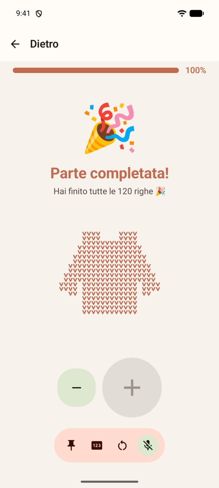

Lo schermo resta acceso finché il contatore è aperto (disattivabile nelle
Impostazioni).

## 4. Le note — istruzioni al momento giusto

Le istruzioni tipo "alla riga 19 diminuisci di due" diventano **note**:
compaiono da sole, evidenziate, **quando stai per fare quella riga** — e in
anteprima già alla riga prima ("Prossima: riga 19 · diminuisci di due").

Dal contatore: icona **📌 Note → Aggiungi nota**.

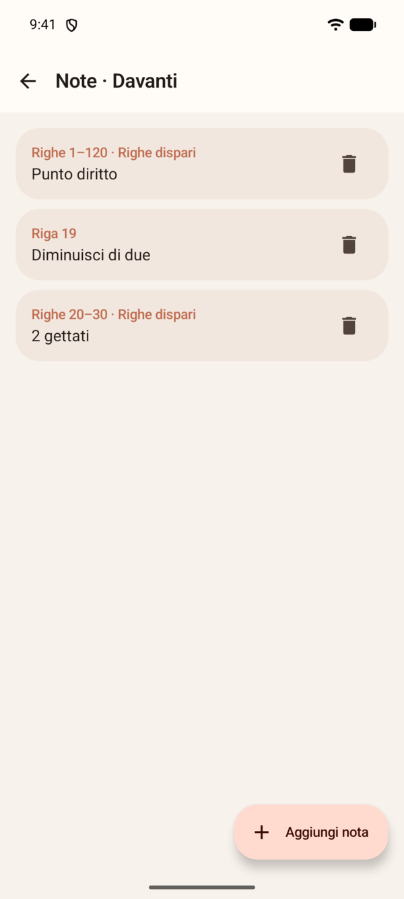
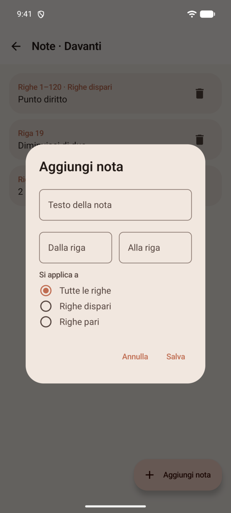

Una nota ha:
- **Testo**: l'istruzione ("diminuisci di due", "cambia colore"…)
- **Dalla riga / Alla riga**: una riga sola (19–19) o un intervallo (20–30)
- **Si applica a**: tutte le righe, solo **dispari** o solo **pari**

Esempi presi dalla pratica:

| Istruzione del modello | Come la inserisci |
|---|---|
| "Alla riga 19 diminuisci di 2" | riga 19–19, tutte le righe |
| "Dalla 20 alla 25 diminuisci di 2" | righe 20–25, tutte le righe |
| "Le righe dispari a punto diritto" | righe 1–120, righe dispari |
| "Dispari dalla 20 alla 30: 2 gettati" | righe 20–30, righe dispari |

All'inizio del lavoro inserisci tutte le istruzioni del modello: poi pensi
solo a premere **+**. Tocca una nota per modificarla, il cestino per
eliminarla.

## 5. Impostazioni

Si aprono dall'ingranaggio nella schermata principale.

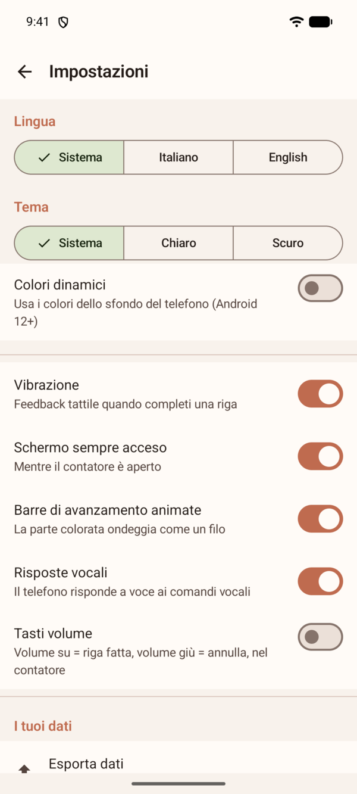

- **Lingua**: Sistema / Italiano / English — cambio immediato.
- **Tema**: Sistema / Chiaro / Scuro.
- **Colori dinamici**: usa i colori dello sfondo del telefono (Android 12+)
  al posto della palette di Majon.
- **Vibrazione**: feedback tattile quando completi una riga.
- **Schermo sempre acceso**: mentre il contatore è aperto.
- **Barre di avanzamento animate**: attiva o disattiva l'ondeggiamento della
  parte colorata. Spento, le barre restano piatte.
- **Risposte vocali**: il telefono risponde a voce ai comandi vocali (riga
  attuale, note, righe rimaste). Spento, i comandi funzionano in silenzio.
- **Tasti volume**: nel contatore, volume su = riga fatta, volume giù =
  annulla. Spento per impostazione predefinita.

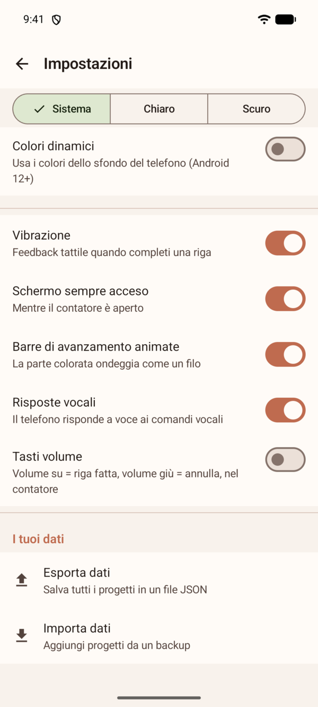

## 6. Backup dei dati

I dati vivono solo sul tuo telefono. Per non perderli, in Impostazioni →
**I tuoi dati**:

- **Esporta dati**: salva tutto (progetti, parti, conteggi, note) in un file
  JSON dove preferisci (Drive, Download…).
- **Importa dati**: ricarica un backup. I progetti importati si **aggiungono**
  a quelli esistenti, niente viene sovrascritto. L'importazione è tutto o
  niente: se il file non è valido non cambia nulla.

Utile per cambiare telefono o per sicurezza prima di fare pulizia.

## Domande frequenti

**Ho premuto + per sbaglio.** Premi **−**.

**Ho perso il conto.** Conta le righe sul lavoro e usa l'icona **123**
(**Vai alla riga…**).

**Posso fare più progetti insieme?** Sì, senza limiti: ogni progetto e ogni
parte mantengono il proprio conteggio.

**Le note si cancellano quando azzero il contatore?** No, restano salvate.

**Se tocco + velocemente perdo dei conteggi?** No: ogni tocco viene contato.

**L'app chiede permessi?** Solo il microfono, e solo se attivi i comandi
vocali nel contatore. L'app non usa internet, non ha pubblicità e non salva
l'audio: i dati restano tuoi.

**I comandi vocali non capiscono.** Parla chiaro e con frasi brevi; controlla
che la lingua dell'app sia installata nel riconoscimento vocale del telefono
(Impostazioni di Android → Lingue → Digitazione vocale).
